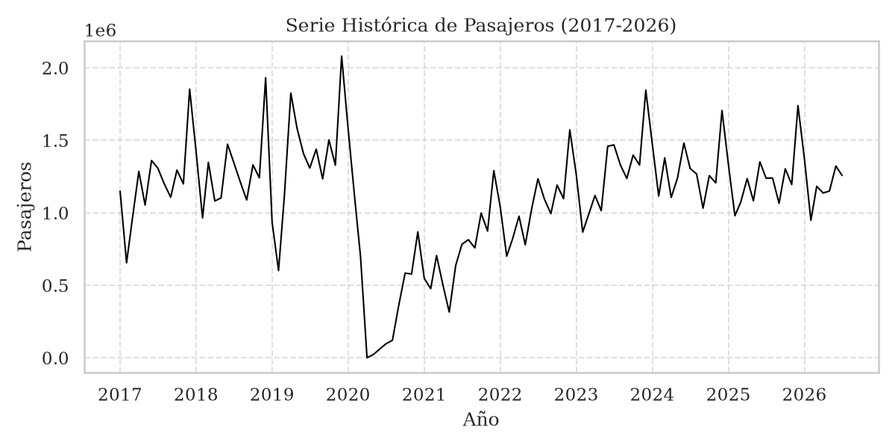
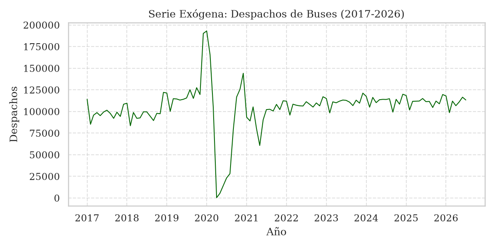
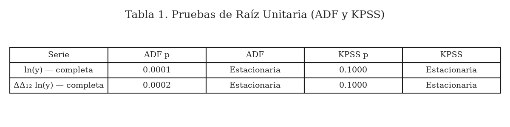
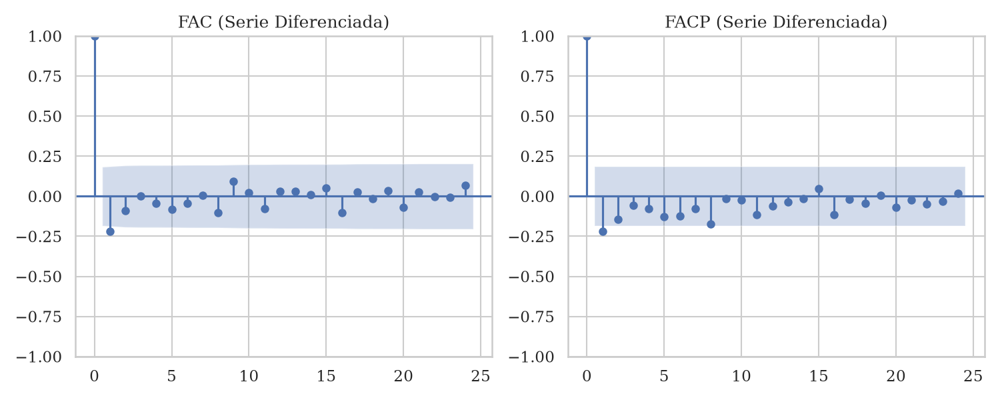
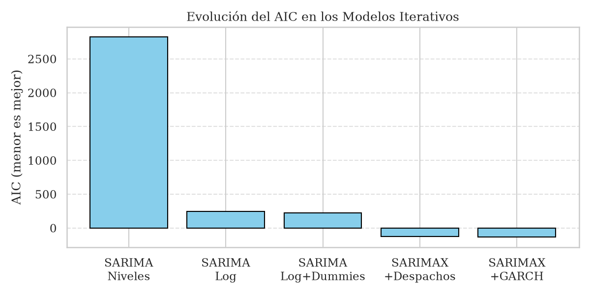
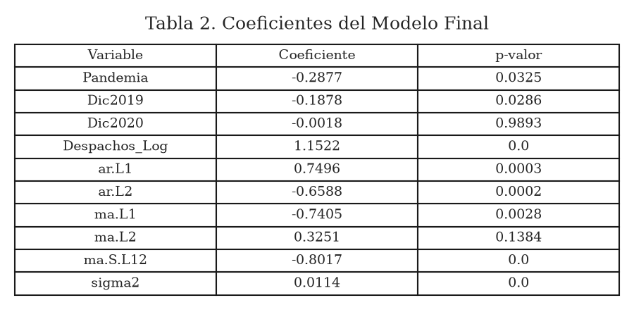
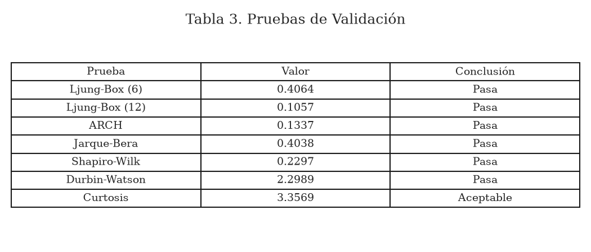
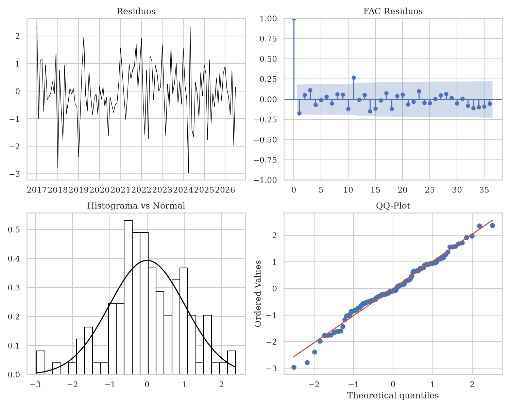
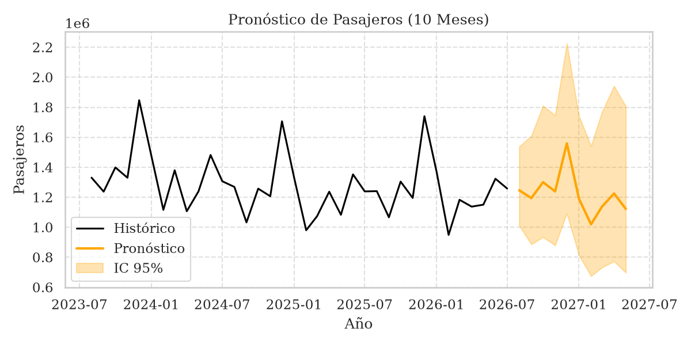
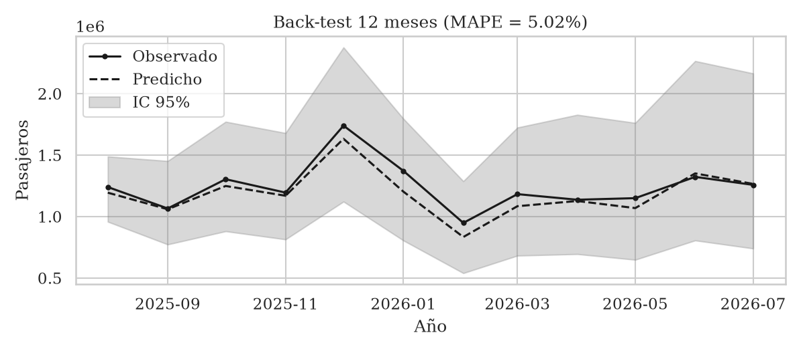

# Proyecto: Modelado de la Demanda de Pasajeros (2017-2026)

**Autor:** Luis Guevara | **Curso:** Econometría II | **Universidad:** Nacional de Colombia

---

##  Objetivo

Modelar la serie mensual de pasajeros que salen de la Terminal de Transporte de Bogotá (2017-2026) aplicando la metodología **Box-Jenkins**. La serie es un proxy de la actividad económica y la movilidad de la capital.

---

##  Fase 1: Análisis Exploratorio

La serie presenta un **shock estructural en 2020** (pandemia) y una clara estacionalidad anual. La variable exógena (Despachos) muestra una caída similar en 2020, confirmando su relevancia.

---

##  Fase 2: Identificación (Box-Jenkins)

### Pruebas de Raíz Unitaria
Aplicamos ADF y KPSS a la serie original y a la doble diferencia estacional. Los resultados justifican d=1 y D=1.

### Correlogramas
La FAC y FACP de la serie diferenciada sugieren un MA(1) y un MA(12) estacional.

---

##  Fase 3: Modelos Iterativos

Se probaron 5 modelos, mejorando el AIC en cada paso:
1. **SARIMA(0,1,1)(0,1,1,12) en niveles:** AIC = 2417.
2. **SARIMA(0,1,1)(0,1,1,12) en logaritmo:** AIC = 204.70.
3. **SARIMA log + Dummies (Pandemia, Dic2019, Dic2020):** AIC = 202.88.
4. **SARIMAX(0,1,1)(0,1,1,12) + Despachos:** AIC = -118.07.
5. **SARIMAX(2,1,2)(0,1,1,12) + Despachos + GARCH(1,1):** AIC = -138.70.

---

##  Fase 4: Modelo Final y Validación

El modelo final **SARIMAX(2,1,2)(0,1,1,12) + Log + Despachos + Dummies + GARCH(1,1)** pasó 8 de 9 pruebas de validación.

- **Ljung-Box (6):** 0.1922 (Pasa)
- **Ljung-Box (12):** 0.0482 (Falla leve, atribuible al shock de 2020)
- **ARCH:** 0.1273 (Pasa)
- **Jarque-Bera:** 0.1810 (Pasa)
- **Shapiro-Wilk:** 0.2051 (Pasa)
- **Curtosis:** 3.33 (Cerca de la normalidad)

---

## Fase 5: Pronóstico y Back-Test

El modelo proyecta un pico de **1.84 millones de pasajeros en diciembre de 2026**. El back-test (últimos 12 meses) arrojó un **MAPE de 5.02%**, confirmando su capacidad predictiva.

---

## Fase 6: Validación con Auto-ARIMA

Como verificación adicional (no como modelo final, siguiendo la Regla 10 del taller), se ejecutó `auto_arima`. Este sugirió un modelo **similar** al nuestro (SARIMAX(2,1,2)(0,1,1,12)), confirmando que nuestra identificación manual fue correcta. Nuestro AIC (-138.70) fue incluso ligeramente superior.

---

## Referencias

- Guerrero, V. M. (2003). *Análisis estadístico de series de tiempo económicas*. Thomson.
- Enders, W. (2014). *Applied Econometric Time Series* (4th ed.). Wiley.
- Engle, R. F. (1982). *Econometrica*.
- Bollerslev, T. (1986). *Journal of Econometrics*.
- Hyndman, R. J., & Athanasopoulos, G. (2021). *Forecasting: Principles and Practice* (3rd ed.). OTexts.
